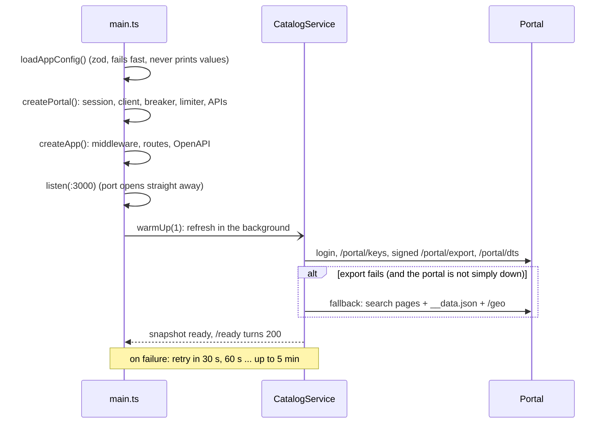
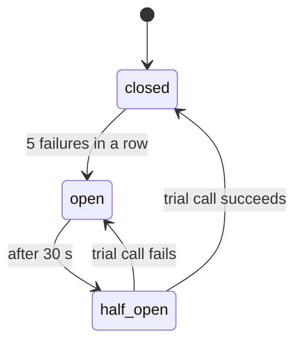
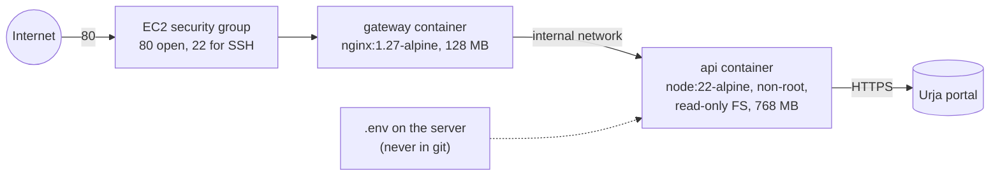

# Architecture

This page shows how the service is built, why it is split this way, and what
happens to one real request from start to finish. For the portal side (how
the old system behaves), see [`../PROTOCOL.md`](../PROTOCOL.md).

> **Prefer pictures?** [`SYSTEM_DESIGN.md`](SYSTEM_DESIGN.md) shows the same
> design as diagrams: the HLD (system context, deployment, layers), the LLD
> (module map, object wiring, class diagrams, domain model) and step-by-step
> flows for startup, catalog reads, readings, retries and errors.

## 1. The big picture


One process keeps all its state in memory: the catalog snapshot, the readings
cache, the rate-limit counters and the circuit breaker. That is a deliberate
choice for a single instance (see "No Redis yet" in the README).

## 2. Layers, and the one rule between them

Dependencies point one way only: `http -> api -> services -> domain`, and
`services -> portal`. Nothing in `domain/` imports Express, `fetch` or the
portal's field names.

| Layer | Folder | Knows about | Does not know about |
|---|---|---|---|
| Composition root | `src/main.ts` | everything (it wires the parts together) | — |
| HTTP plumbing | `src/http/` | Express, headers, status codes, OpenAPI | meters, the portal |
| Product API | `src/api/` | our routes and response shapes | portal spelling, retries |
| Services | `src/catalog/`, `src/readings/`, `src/anomalies/` | caching, freshness, time windows | HTTP |
| Domain | `src/domain/`, `src/geo/`, `src/quality/` | the clean model and the rules | HTTP, portal calls |
| Portal adapter | `src/portal/` | every portal quirk: cookies, signing, devalue, numbers sent as strings | our API |
| Shared | `src/shared/` | generic tools: cache, breaker, limiter | anything above |

The portal adapter is an **anti-corruption layer**. The portal's odd shapes
(numbers as strings, `DD/MM/YYYY HH:mm` dates, name and code in one string,
two different detail page shapes) stop there. Everything above it sees clean,
typed data.

Why this split helps:

- Tests can build the whole app with a fake portal and a fake clock, because
  only `main.ts` reads env, opens a port or talks to the real portal.
- If the portal changes, the fix stays in `src/portal/`. Its zod schemas fail
  loudly instead of passing bad data upward.
- The domain functions (`deriveReadings`, `detectMeterAnomalies`,
  `transformerLoad`) are pure, so they are tested with plain arrays.

## 3. Startup



`/health` returns 200 as soon as the process is up (liveness). `/ready`
returns 503 until the first catalog load works (readiness). That way Docker
and a load balancer don't send traffic before there is any data.

## 4. Two kinds of data, two strategies

| | Catalog (meters, network, transformers) | Readings (energy) |
|---|---|---|
| Size | 403 meters, under 1 MB | per month: 1440 rows for each of the 40 half-hourly meters, 30 rows for each of the 363 daily meters |
| Portal cost | 1 signed export call (+ `/portal/dts`) | 1 call per meter per range of days |
| Strategy | Load everything once, keep a read-only indexed snapshot | Fetch when asked for, cache per (meter, days) |
| Freshness | Fresh for 15 min, then served while it refreshes in the background; served on error for up to 24 h | Lifetime depends on data age: old history 1 h, live data until the next reading (30 s to 5 min); served on error for up to 6 h |
| Code | `catalog/catalogService.ts`, `catalogSnapshot.ts` | `readings/readingsService.ts`, `shared/ttlCache.ts` |

## 5. Walkthrough: one readings request

The request:

```
GET /v1/meters/J100013/readings?from=2026-06-29&to=2026-06-29&granularity=hour
X-API-Key: <key>
```

Step by step, with the file that does each step:

1. **nginx** (`deploy/nginx.conf`): GET is allowed. The per-IP rate limit
   (20 requests/s, burst 40) passes. nginx adds `X-Forwarded-For` and
   `X-Request-Id`, then forwards to `api:3000`.
2. **requestId** (`http/middleware.ts`): reuses the incoming `X-Request-Id`
   (or creates a UUID) and sends it back on the response.
3. **accessLog**: notes the start time. When the response finishes, it writes
   one JSON line (method, path, status, ms, consumer, request id).
4. **cors**, **helmet**, **compression**: CORS headers only if the origin is in
   `CORS_ORIGINS`, security headers, and gzip if the client accepts it.
5. **apiKeyAuth**: reads `X-API-Key` (or `Authorization: Bearer`), hashes it
   with SHA-256 and compares it in constant time with the configured hashes.
   Unknown key → `401` problem+json. Known key → `res.locals.consumer =
   "tester"`. Only the name goes to the logs, never the key.
6. **perConsumerRateLimit**: 300 requests a minute per consumer, with the
   standard `RateLimit` headers. Over the limit → `429` problem+json.
7. **Route registry** (`http/routeRegistry.ts`): checks `params` and `query`
   against the zod schemas declared on the route (`api/schemas.ts`).
   `from=2026-06-29` becomes IST midnight, and a date-only `to` means the end
   of that day. A bad value → `400` with a list of field errors. The handler
   gets typed values.
8. **Handler** (`api/routes.ts`): checks that the meter exists in the catalog
   snapshot. Unknown id → `404`, without calling the portal.
9. **ReadingsService.get** (`readings/readingsService.ts`):
   - `resolveWindow`: the window is [29 Jun 00:00, 30 Jun 00:00) IST. It
     checks that from < to and that the span is at most 31 days.
   - `portalDaysFor`: the reading that closes the last half hour is stamped
     30 Jun 00:00, so the portal is asked for `from=2026-06-29&to=2026-06-30`.
   - cache key `J100013|2026-06-29..2026-06-30` → `TtlCache.getOrLoad`. On a
     hit, there is no portal call. On a miss, identical requests that arrive
     at the same time share one load (single-flight).
10. **Portal adapter** (`portal/energyApi.ts` → `portal/portalClient.ts`):
    - the **concurrency limiter** waits for one of 4 slots (queue of 200);
    - the **circuit breaker** rejects straight away with `503` if it is open;
    - the **session** adds the cookie (logging in first if needed);
    - `GET /portal/meters/J100013/energy?from=...&to=...` runs with a timeout
      and retries on 5xx, 429 and network errors. A `401` triggers one
      re-login;
    - the JSON is checked against `energyResponseSchema` (zod).
11. **Domain** (`domain/readings.ts`): `deriveReadings` reads
    `DD/MM/YYYY HH:mm` as IST, sorts the rows, and works out interval kWh (the
    difference between registers, rounded to 6 decimals) and power factor
    (kWh ÷ kVAh). Gaps, duplicates or a falling register are recorded as
    `issues`. The cache stores the result with a lifetime based on the newest
    reading's age (June data → 1 hour).
12. **Back in the handler**: `inWindow` keeps the 48 half hours of 29 June.
    `aggregate(..., "hour")` adds them up into 24 hour buckets
    (`complete: false` if a half hour is missing). `summarize` gives totals,
    min/max and average power factor.
13. **Response**: the body has the `readingsResponse` shape (the tests check
    every response against it). The handler sets
    `Cache-Control: private, max-age=N` and `X-Cache: MISS|HIT|STALE`, and
    sends JSON with `meta`.

If anything throws, Express 5 passes it to **errorHandler**
(`http/problem.ts`), which turns it into RFC 9457 problem+json:

- `ApiError` keeps its own status.
- `PortalAuthError` and an unexpected portal shape (`PortalProtocolError`) → 502.
- `PortalUnavailableError` and an open breaker → 503 with `Retry-After`.
- Anything else → 500, with no internal details.

## 6. When things go wrong



| What breaks | What the client sees |
|---|---|
| Portal slow or down, catalog cached | Catalog routes keep answering from memory; `meta.stale` turns true after 15 min |
| Portal down, readings cached | Cached readings are served with `X-Cache: STALE` for up to 6 h |
| Portal down, nothing cached | `503` with `Retry-After` (instant once the breaker is open) |
| Portal rejects our login | `502` (our upstream problem, not the client's) |
| Signed export changes or breaks | Catalog is rebuilt from the UI's own pages; `meta.source: "fallback"` |
| Portal sends an unexpected shape | zod rejects it, the error is logged with the path, the old snapshot keeps serving |
| Portal rate limits us (`429`) | The client waits and retries; if it keeps happening, `503 upstream_rate_limited` with `Retry-After` |
| A client sends too many requests | `429` from nginx (per IP) or from the app (per key) |

Only real health problems count toward the breaker: unreachable, timeouts,
5xx after retries, a broken login. A `404` means the portal is fine, and a
`429` means it is healthy but busy, so neither opens the breaker.

## 7. Deployment shape



Only the gateway publishes a port. The API container can only be reached
inside the Compose network. The full picture, with CI/CD, is in
[SYSTEM_DESIGN.md](SYSTEM_DESIGN.md#12-deployment-and-cicd).

## 8. Patterns used, by name

| Pattern | Where |
|---|---|
| Anti-corruption layer | `src/portal/` |
| Composition root / dependency injection through constructors | `src/main.ts`, `createPortal.ts`, `createApp` |
| Read-only snapshot, swapped in one step | `catalogSnapshot.ts`, `catalogService.ts` |
| Stale-while-revalidate, stale-if-error | `catalogService.ts`, `ttlCache.ts` |
| Single-flight (request coalescing) | `session.ts`, `ttlCache.ts`, `catalogService.ts` |
| Circuit breaker | `shared/circuitBreaker.ts` |
| Bulkhead (concurrency limit with a bounded queue) | `shared/concurrencyLimiter.ts` |
| Retry with backoff | `portal/portalClient.ts` |
| Schema-first contracts (one source for validation, types and docs) | `http/routeRegistry.ts`, `api/schemas.ts` |
| Fallback data source | `portal/fallbackApi.ts`, `portalCatalogLoader.ts` |
| Spatial index | `geo/spatialGrid.ts` |
| Liveness vs readiness probes | `/health`, `/ready` |
| Graceful shutdown | `main.ts` (on SIGTERM: stop taking requests, finish the running ones, 10 s limit) |

## 9. More diagrams

| Want to see | Diagram in SYSTEM_DESIGN.md |
|---|---|
| Who talks to whom, and where it runs | [System context](SYSTEM_DESIGN.md#11-system-context), [Deployment and CI/CD](SYSTEM_DESIGN.md#12-deployment-and-cicd) |
| Which file imports which | [Module map](SYSTEM_DESIGN.md#21-module-map) |
| Who creates which object at startup | [Object wiring](SYSTEM_DESIGN.md#22-object-wiring-at-startup-composition-root) |
| Classes and methods | [Portal adapter](SYSTEM_DESIGN.md#23-classes-portal-adapter), [Services](SYSTEM_DESIGN.md#24-classes-services-and-shared-tools), [HTTP](SYSTEM_DESIGN.md#25-classes-http-layer), [Domain model](SYSTEM_DESIGN.md#26-domain-model) |
| The request in section 5, as a sequence diagram | [Readings route](SYSTEM_DESIGN.md#35-get-v1metersidreadings-readings-route) |
| How freshness and caching decide | [CatalogService.read()](SYSTEM_DESIGN.md#34-catalogserviceread), [TtlCache.getOrLoad()](SYSTEM_DESIGN.md#36-ttlcachegetorload) |
| How a portal call is retried | [PortalClient.get()](SYSTEM_DESIGN.md#37-portalclientget-limiter-breaker-retries) |
