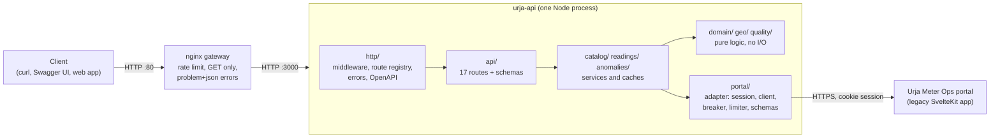
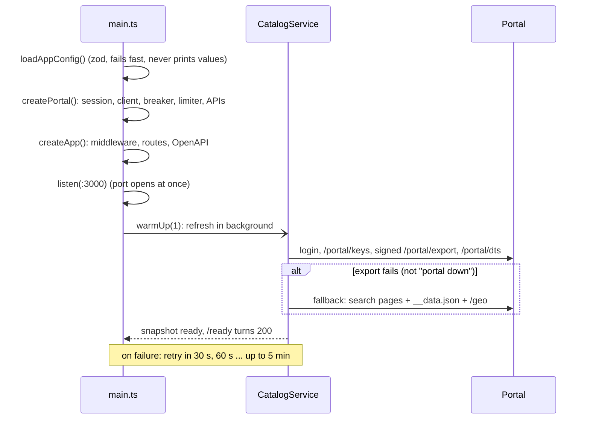
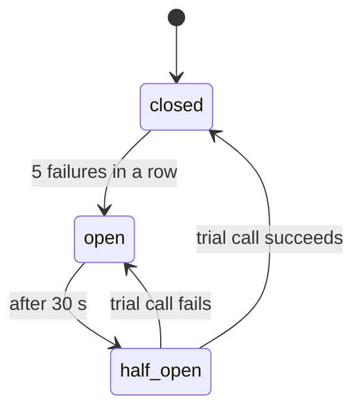
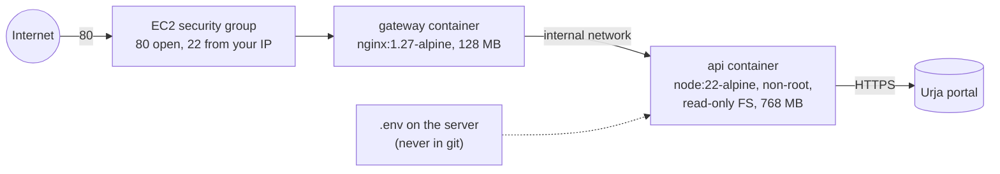

# Architecture

How the service is put together, why it is split this way, and what happens
on one real request from the first byte to the response. For the portal side
(what the legacy system does) see [`../PROTOCOL.md`](../PROTOCOL.md).

## 1. The big picture



One process holds all state in memory: the catalog snapshot, the readings
cache, rate-limit counters and the circuit breaker. That is deliberate for one
instance (README, "No Redis (yet)").

## 2. Layers and the rule between them

Dependencies point one way: `http -> api -> services -> domain`, and
`services -> portal`. Nothing in `domain/` imports Express, `fetch` or the
portal's field names.

| Layer | Folder | Knows about | Does not know about |
|---|---|---|---|
| Composition root | `src/main.ts` | everything (wires it together) | — |
| HTTP plumbing | `src/http/` | Express, headers, status codes, OpenAPI | meters, the portal |
| Product API | `src/api/` | our routes and response shapes | portal spelling, retries |
| Services | `src/catalog/`, `src/readings/`, `src/anomalies/` | caching, freshness, windows | HTTP |
| Domain | `src/domain/`, `src/geo/`, `src/quality/` | the clean model and rules | HTTP, portal I/O |
| Portal adapter | `src/portal/` | every portal quirk: cookies, signing, devalue, string numbers | our API |
| Shared | `src/shared/` | generic tools: cache, breaker, limiter | anything above |

The portal adapter is an **anti-corruption layer**: the portal's odd shapes
(numbers as strings, `DD/MM/YYYY HH:mm`, name and code in one string, two
detail shapes) stop there. Everything above it sees typed, normalized data.

Why this split pays off:

- Tests build the app with a fake portal and a fake clock, because only
  `main.ts` reads env, opens a port or talks to the real portal.
- If the portal changes, the change is in `src/portal/` and its schemas,
  which fail loudly (zod) instead of passing bad data upward.
- The domain functions (`deriveReadings`, `detectMeterAnomalies`,
  `transformerLoad`) are pure, so they are tested with plain arrays.

## 3. Startup



`/health` answers 200 as soon as the process is up (liveness). `/ready`
answers 503 until the first catalog load succeeds (readiness), so Docker and a
load balancer do not send traffic before there is data.

## 4. Two kinds of data, two strategies

| | Catalog (meters, network, transformers) | Readings (energy) |
|---|---|---|
| Size | 403 meters, under 1 MB | 1440 rows per meter per month |
| Portal cost | 1 signed export call (+ `/portal/dts`) | 1 call per meter per day range |
| Strategy | Load everything, keep an indexed immutable snapshot | Fetch on demand, cache per (meter, days) |
| Freshness | Fresh 15 min, then stale-while-revalidate; stale-if-error up to 24 h | TTL from data age: old history 1 h, live data until the next reading (30 s to 5 min); stale-if-error up to 6 h |
| Code | `catalog/catalogService.ts`, `catalogSnapshot.ts` | `readings/readingsService.ts`, `shared/ttlCache.ts` |

## 5. Dry run: one readings request

Request:

```
GET /v1/meters/J100013/readings?from=2026-06-29&to=2026-06-29&granularity=hour
X-API-Key: <key>
```

Step by step, with the file that does each step:

1. **nginx** (`deploy/nginx.conf`): method is GET, so allowed; per-IP rate
   limit (20 r/s, burst 40) passes; adds `X-Forwarded-For` and
   `X-Request-Id`; forwards to `api:3000`.
2. **requestId** (`http/middleware.ts`): reuses the incoming `X-Request-Id`
   (or makes a UUID) and echoes it on the response.
3. **accessLog**: notes the start time; one JSON line is written when the
   response finishes (method, path, status, ms, consumer, request id).
4. **cors**, **helmet**, **compression**: CORS headers only if the origin is in
   `CORS_ORIGINS`; security headers; gzip if the client accepts it.
5. **apiKeyAuth**: reads `X-API-Key` (or `Authorization: Bearer`), hashes it
   with SHA-256 and compares in constant time with the configured hashes.
   Unknown key → `401` problem+json. Known key → `res.locals.consumer = "web"` (the name, never the key, goes to logs).
6. **perConsumerRateLimit**: 300 requests per minute per consumer name
   (standard `RateLimit` headers) → otherwise `429` problem+json.
7. **Route registry** (`http/routeRegistry.ts`): validates `params` and
   `query` with the zod schemas declared on the route (`api/schemas.ts`).
   `from=2026-06-29` is parsed as IST midnight; a date-only `to` means the end
   of that day. A bad value → `400` with a list of field errors. The handler
   receives typed values.
8. **Handler** (`api/routes.ts`): checks the meter exists in the catalog
   snapshot. Unknown id → `404` without calling the portal.
9. **ReadingsService.get** (`readings/readingsService.ts`):
   - `resolveWindow`: window = [29 Jun 00:00, 30 Jun 00:00) IST; checks
     from < to and span ≤ 31 days.
   - `portalDaysFor`: the reading that closes the last half hour is stamped
     30 Jun 00:00, so the portal days are `from=2026-06-29&to=2026-06-30`.
   - cache key `J100013|2026-06-29..2026-06-30` → `TtlCache.getOrLoad`. On a
     hit, no portal call. On a miss, concurrent identical requests share one
     load (single-flight).
10. **Portal adapter** (`portal/energyApi.ts` → `portal/portalClient.ts`):
    - the **concurrency limiter** waits for one of 4 slots (queue of 200);
    - the **circuit breaker** rejects at once with `503` if it is open;
    - the **session** adds the cookie (logging in first if needed);
    - `GET /portal/meters/J100013/energy?from=...&to=...` with a timeout and
      retries on 5xx/429/network errors; a `401` triggers one re-login;
    - the JSON is validated with `energyResponseSchema` (zod).
11. **Domain** (`domain/readings.ts`): `deriveReadings` parses
    `DD/MM/YYYY HH:mm` as IST, sorts, and computes interval kWh (difference of
    registers, rounded to 6 decimals) and power factor (kWh/kVAh), recording
    gaps, duplicates or a falling register as `issues`. The cache stores this
    with a TTL picked from the newest reading's age (June data → 1 hour).
12. **Back in the handler**: `inWindow` keeps the 48 intervals of 29 June,
    `aggregate(..., "hour")` sums them into 24 hour buckets (`complete:
    false` if a half hour is missing), `summarize` gives totals, min/max and
    average power factor.
13. **Response**: the body has the `readingsResponse` shape (the tests check
    every response against it), the handler sets `Cache-Control: private, max-age=N` and `X-Cache:
    MISS|HIT|STALE`, and sends JSON with `meta`.

If anything throws, Express 5 forwards it to **errorHandler**
(`http/problem.ts`), which maps it to RFC 9457 problem+json: `ApiError` keeps
its status, `PortalAuthError` and an unexpected portal shape (`PortalProtocolError`) → 502, `PortalUnavailableError` and an open
breaker → 503 with `Retry-After`, anything unknown → 500 with no internals.

## 6. Failure behaviour



| What breaks | What the client sees |
|---|---|
| Portal slow or down, catalog cached | Catalog routes keep answering from memory, `meta.stale` becomes true after 15 min |
| Portal down, readings cached | Cached readings are served with `X-Cache: STALE` for up to 6 h |
| Portal down, nothing cached | `503` with `Retry-After` (fast, once the breaker is open) |
| Portal login rejected | `502` (our upstream problem, not the client's) |
| Signed export changes or breaks | Catalog rebuilt from the UI's own pages; `meta.source: "fallback"` |
| Portal returns an unexpected shape | zod rejects it; the error is logged with the path; the old snapshot keeps serving |
| Too many requests | `429` from nginx (per IP) or the app (per key) |

Only "unhealthy" errors count toward the breaker (unreachable, timeouts,
5xx/429 after retries, login broken). A `404` means the portal is fine.

## 7. Deployment shape



Only the gateway publishes a port. The API container is reachable only on the
Compose network. Details in [`DEPLOY_AWS.md`](DEPLOY_AWS.md).

## 8. Patterns used, by name

| Pattern | Where |
|---|---|
| Anti-corruption layer | `src/portal/` |
| Composition root / dependency injection by constructor | `src/main.ts`, `createPortal.ts`, `createApp` |
| Immutable snapshot, swapped atomically | `catalogSnapshot.ts`, `catalogService.ts` |
| Stale-while-revalidate, stale-if-error | `catalogService.ts`, `ttlCache.ts` |
| Single-flight (request coalescing) | `session.ts`, `ttlCache.ts`, `catalogService.ts` |
| Circuit breaker | `shared/circuitBreaker.ts` |
| Bulkhead (concurrency limit with bounded queue) | `shared/concurrencyLimiter.ts` |
| Retry with backoff | `portal/portalClient.ts` |
| Schema-first contracts (one source for validation, types and docs) | `http/routeRegistry.ts`, `api/schemas.ts` |
| Fallback data source | `portal/fallbackApi.ts`, `portalCatalogLoader.ts` |
| Spatial index | `geo/spatialGrid.ts` |
| Liveness vs readiness probes | `/health`, `/ready` |
| Graceful shutdown | `main.ts` (SIGTERM: stop accepting, drain, 10 s deadline) |
